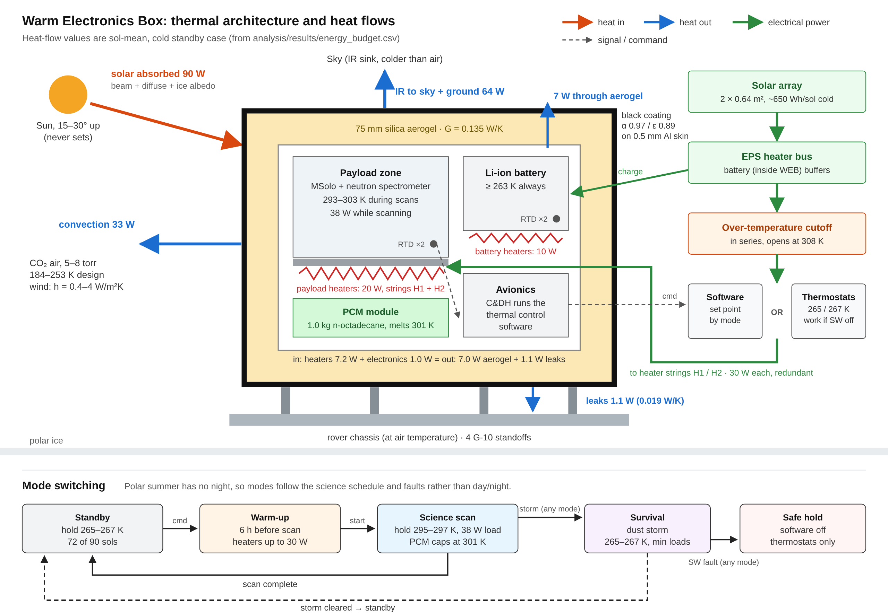

# Mars Polar Rover – Thermal Control Subsystem

**An independent systems engineering revision of a Mars rover thermal control subsystem originally developed through the L'SPACE NASA Mission Concept Academy in Spring 2023.**

## Project Overview

In Spring 2023, I developed the thermal control subsystem for a solar-powered rover concept designed to explore the Martian Northern Polar Ice Caps as part of L'SPACE Mission Concept Academy (Team 20). The mission focused on studying layered ice deposits and identifying potential resources.

My work focused on developing a thermal control approach to protect the science payload from the extreme temperatures of the Martian polar environment while maintaining its operating temperature range of 293–303 K.

The original design was documented in a Preliminary Design Review (PDR). However, the thermal analysis had unresolved issues, including inconsistencies in the heat balance calculations and the absence of a fully sized heater system and detailed verification plan.

In 2026, I revisited the subsystem to develop a more complete engineering design. The objective was to take the original concept beyond its preliminary design stage by improving the analysis, evaluating alternative design approaches, and establishing a structured verification strategy.

The revised work focuses on:

- **Requirements Engineering:** Refining system requirements and establishing traceability to verification methods.
- **Thermal Analysis:** Developing a repeatable thermal model and verifying the heat transfer calculations.
- **Design Trade Studies:** Evaluating insulation materials, heating strategies, and thermal control configurations.
- **Systems Architecture:** Defining subsystem components, interfaces, and operational modes.
- **Model-Based Systems Engineering:** Developing a SysML v2 model to document the subsystem architecture and relationships.
- **Verification & Testing:** Establishing verification criteria, test procedures, and failure scenarios.



## Key Results

The revised analysis and design studies produced the following results:

- **Reduced heating demand:** The original configuration required approximately 275 W of heating to maintain the payload at 295 K. A proposed 75 mm silica aerogel enclosure reduced the estimated cold-case heating demand to 12 W.
- **Operational energy savings:** Restricting payload heating to the 18 science sols within the 90-sol mission reduced heater energy consumption by an estimated 36–75%, while maintaining the required temperature during science operations.
- **Thermal buffering:** A 1.0 kg phase-change material (PCM) concept was evaluated to absorb heat during a 38 W, two-hour science scan, limiting the payload temperature to approximately 301 K compared with 321 K without the PCM.
- **Failure analysis:** Three design vulnerabilities were identified and addressed through changes to the warm-up sequence, survival temperature set point, and heater over-temperature protection. The modeled stuck-on heater scenario reduced peak temperature from 423 K to 308 K.
- **Requirements traceability:** Twelve subsystem requirements were mapped to verification methods and defined acceptance criteria.

## Repository Structure

| Directory | Contents |
|---|---|
| [`docs/`](docs/) | Full thermal subsystem design document and portfolio case study |
| [`analysis/`](analysis/) | MATLAB thermal model, calculations, verification checks, and trade studies |
| [`model/`](model/) | SysML v2 system model and associated diagrams |
| [`figures/`](figures/) | Thermal analysis plots, architecture diagrams, and supporting visuals |

**Start here:** [`docs/thermal_subsystem_design.md`](docs/thermal_subsystem_design.md)

## Running the Thermal Model

The thermal analysis is implemented in MATLAB.

```matlab
cd analysis
run_all
```

The script runs the model verification checks, hand calculations, design cases, energy budget, failure scenarios, and trade studies. It also regenerates the associated plots.

The model takes approximately two minutes to run and does not require additional MATLAB toolboxes.

Model inputs and assumptions are documented in `thermal_params.m`, with each parameter identified by its source: original PDR, published reference, engineering assumption, or design decision.

An optional Simulink implementation is available in `analysis/simulink/` to represent the thermal model as a block diagram and compare its outputs against the MATLAB implementation.

## Verification & Validation

An important distinction in this project is the difference between model verification and physical validation.

**Verification:** The analytical model has been checked using automated tests and independent hand calculations to confirm that the implemented equations and calculations are consistent.

**Validation:** The physical performance of the proposed thermal system has not been experimentally validated. This would require hardware testing under representative environmental conditions, including the Mars-environment chamber test (CO₂ at Mars surface pressure) proposed in the design documentation.

No physical hardware was built as part of this project. The testing procedures and acceptance criteria are engineering plans, not completed experimental tests.

## Engineering Areas

- Systems Engineering
- Requirements Development & Traceability
- Thermal Analysis & Heat Transfer
- MATLAB Modeling and Simulation
- Model-Based Systems Engineering (SysML v2)
- Thermal Control Trade Studies
- Interface Definition
- Failure Analysis & Risk Assessment
- Verification Planning and Test Development

---

*Original subsystem design: L'SPACE NASA Mission Concept Academy, Team 20, Spring 2023. Thermal subsystem developed by Wendy Morara.*

*Independent engineering revision: 2026, Wendy Morara.*
