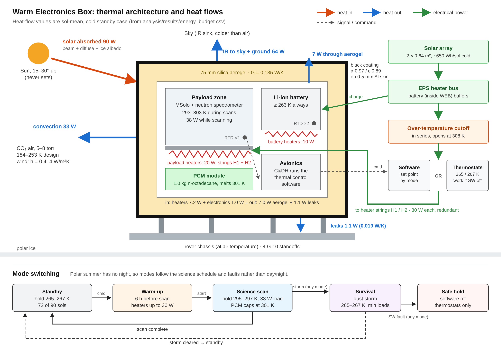
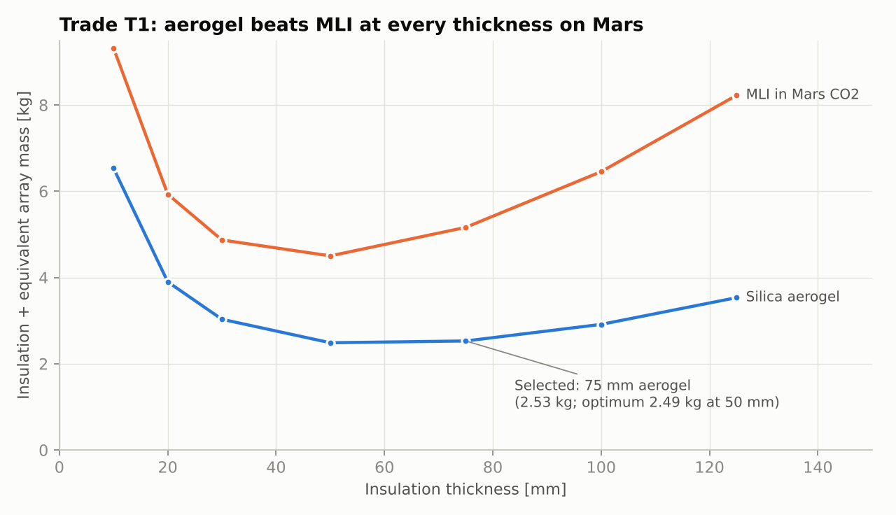
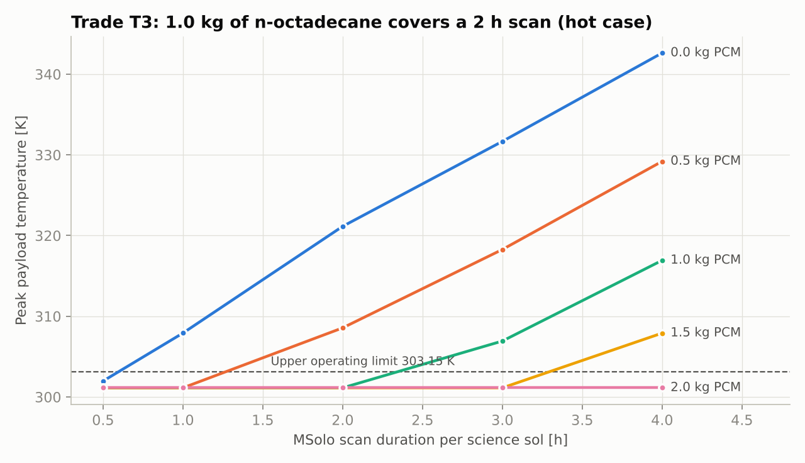
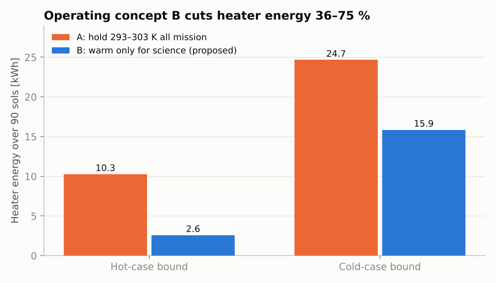
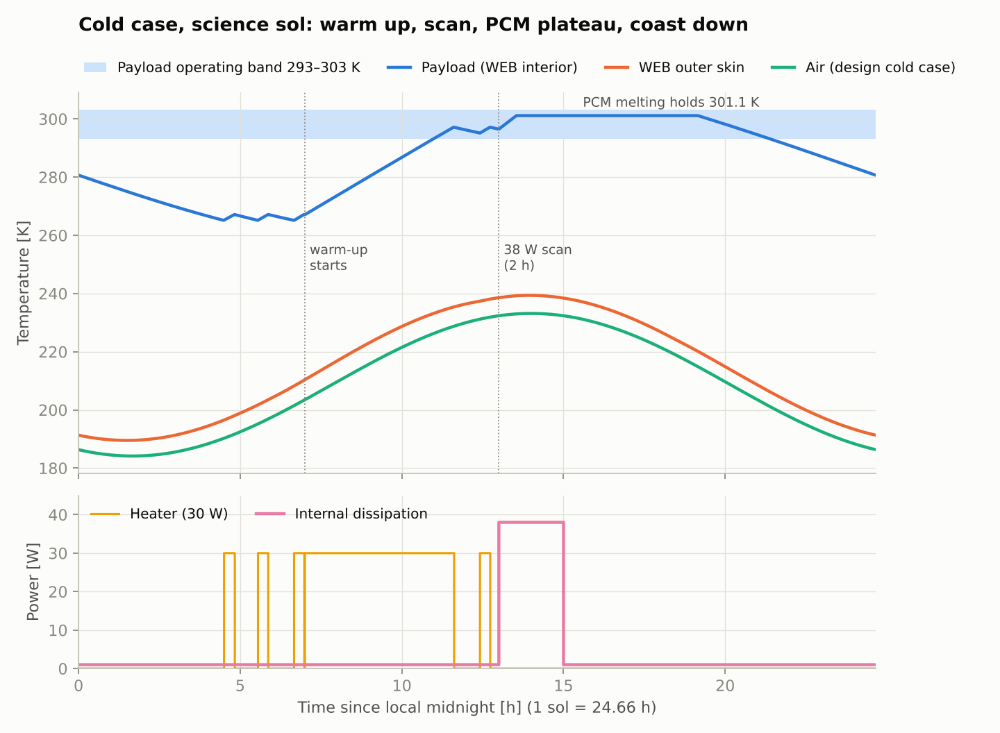

# L'SPACE Mars Polar Rover: Thermal Control Subsystem Design

**Author:** Wendy Morara · **Revision:** 2026 (revises the 2023 L'SPACE Team 20 PDR thermal section) · **Status:** preliminary design, verified by analysis (not validated by test)

---

## Summary

The thermal control subsystem (TCS) keeps the rover's science payload between **293.15 K and 303.15 K** while it scans the Mars north polar ice. The rest of the time it keeps the payload, avionics and battery above a **263.15 K** survival limit, while the air ranges from 184 K to 253 K.

The 2023 analysis never closed its energy balance. This revision does. These results drive the design:

| Result | Number | Design consequence |
|---|---|---|
| The 2023 polycarbonate shell cannot hold temperature | needs **275 W** continuous (cold); the array averages 26–48 W | Insulated Warm Electronics Box (WEB) |
| 75 mm of silica aerogel cuts the heat loss 56× | G = 0.135 W/K vs 7.56 W/K | Aerogel WEB; **30 W** heater per string |
| Holding 293–303 K all 90 sols wastes energy | 24.7 kWh vs **15.9 kWh** (cold bound) | Warm up only for science (concept B) |
| A 38 W, 2 h scan would reach 321 K | **1.0 kg** of n-octadecane caps it at 301.1 K | Phase-change material (PCM) module |
| The 2023 black paint was right | **4×** less heater energy than white (hot case) | Keep AZ-1000-ECB, now justified |
| Failure analysis found three gaps | single-string warm-up short; set point on the limit; stuck heater reaches 423 K | 6 h warm-up, 265 K set point, 308 K cutoff |

All 12 TCS requirements close by analysis or have a defined test, demonstration or inspection.

---

## 1. Mission and requirements

### 1.1 Mission and payload

The rover traverses a ridge on the north polar layered deposits for 90 sols in northern summer. It carries two instruments:

- **MSolo mass spectrometer:** 6.0 kg, 35 W while scanning; it analyses volatiles from the ice.
- **Neutron spectrometer:** 1.6 kg, 1.5 W; it maps subsurface hydrogen.

Both need **293.15–303.15 K** while operating (PDR TSS-3). The PDR science calendar runs them on **18 of the 90 sols**: sols 6, 30–32, 40–42, 45–46, 65 and 75–82.

### 1.2 Environment

In polar summer the sun never sets. It circles 15–30° above the horizon, so there is no night to survive. The "no sun" case is a dust storm, or a fault that stops the array charging.

| Parameter | Hot case | Cold case | Dust storm | Basis |
|---|---|---|---|---|
| Latitude | 85° N | 85° N | 85° N | [ASM A-01] PDR route on the polar cap |
| Season (Ls) | 90° (solstice) | 125° (end of mission) | 125° | [ASM A-02] |
| Sun elevation | 19.9–29.9° | 15.2–25.2° | 15.2–25.2° | computed, verified (V4) |
| Optical depth τ | 0.3 | 1.0 | 3.0 | [ASM] bounding values |
| Air temperature | 204–253 K | 184–233 K | 184–233 K | Phoenix 68° N averages −30/−79 °C [1], ±10 K margin |
| Effective sky temperature | air − 30 K | air − 50 K | air − 50 K | clear Mars sky is colder than air [2]; [ASM A-12] |
| Convection h | 0.4 W/m²K | 4.0 W/m²K | 4.0 W/m²K | Mars Sample Return guideline values [2] |
| Surface albedo | 0.40 | 0.25 | 0.25 | [ASM] ice cap |
| Pressure | 5–8 torr CO₂ | | | [6] |

Solar irradiance comes from the Appelbaum–Flood Mars model [7].

**Scope decision:** PDR TSS-4 lists 133 K, a CO₂-frost (winter) temperature. The mission ends at Ls 125°, before polar night, so winter survival is **out of scope** and stated as such.

### 1.3 Requirements traceability matrix

| ID | Requirement (shall) | Parent | Allocated to | Method | Success criterion | Status |
|---|---|---|---|---|---|---|
| TCS-01 | Hold payload at 293.15–303.15 K from scan start to scan end | TSS-3 | Heaters, PCM, software | Analysis | Hot and cold scan windows within band | **Closed:** 295.3–301.1 K |
| TCS-02 | Keep WEB interior ≥ 263.15 K at all times, including with software off | TSS-1 | Thermostats, heaters, aerogel | Test (proposed) | Chamber test at 184 K walls, thermostats only, interior ≥ 263.15 K | Analysis min 265.1 K; test open |
| TCS-03 | Meet TCS-01/02 for air 184–253 K, τ 0.3–3.0, h 0.4–4.0 W/m²K | TSS-4 | Whole TCS | Analysis | Hot, cold and storm cases all pass | **Closed** |
| TCS-04 | Heater energy ≤ 200 Wh/sol (cold) and ≤ 250 Wh/sol (storm) | TSS-2 | Aerogel, coating, concept B | Analysis | Transient energy per sol under allocation | **Closed:** 176 / 195 Wh |
| TCS-05 | Worst-case heater duty ≤ 70 % at minimum bus voltage | TSS-2 | Heater strings | Analysis | P_installed × 0.70 × 0.81 ≥ P_worst | **Closed:** 17.0 W ≥ 16.4 W |
| TCS-06 | Two independent heater strings, each meeting TCS-01 and TCS-05 alone | TSS-2 | Heater strings | Inspection + analysis | Schematic shows two strings; single string at 24.3 W meets TCS-01 (F1) | Analysis closed: 295.6 K; inspection open |
| TCS-07 | ≥ 2 sensors per heater zone, ±0.5 K accuracy | TSS-2 | RTDs | Inspection | Layout and calibration certificates | Open |
| TCS-08 | Payload ≤ 303.15 K during a 2 h, 38 W scan, hot case | TSS-3 | PCM | Analysis | Peak ≤ 303.15 K with unmelted PCM margin | **Closed:** 301.1 K, 75 % melted |
| TCS-09 | TCS mass ≤ 3.5 kg | System | Whole TCS | Inspection | Weighed flight hardware | Estimate 3.2 kg |
| TCS-10 | ≥ 12 h survival with no solar input | TSS-1 | Aerogel, heaters, battery | Analysis | Battery energy ÷ survival load ≥ 12 h | **Closed:** 16.8 h* |
| TCS-11 | With one string failed ON, interior ≤ 313.15 K | TSS-1 | Over-temperature cutoff | Analysis + test | Stuck-on simulation; cutoff trip test | Analysis closed: 308.2 K |
| TCS-12 | Detect a failed heater string and switch strings within 4 h | TSS-2 | Software, RTDs | Demonstration | Software test bench switchover < 4 h | Open |

\* Depends on 150 Wh of usable battery [ASM A-16]; TCS-10 sets the minimum at 107 Wh.

The 2023 requirements had no rationale, no parents and "Test" for everything. Here every requirement traces to a parent (`#derivation` connections in `model/02_Requirements.sysml`). TCS-11 and TCS-12 came out of the failure analysis (Section 6.4).

---

## 2. Thermal model

### 2.1 Heat paths

| Path | Model | Value |
|---|---|---|
| Solar in | α × (beam on projected area + isotropic diffuse + ice albedo) | α = 0.97 |
| IR out | ε σ [A_sky (T_s⁴ − T_sky⁴) + A_gnd (T_s⁴ − T_gnd⁴)] | ε = 0.89 |
| Convection | h A (T_s − T_air) | h = 0.4–4.0 W/m²K |
| Through insulation | G (T_int − T_s), with G = k √(A_in A_out) / t | 0.135 W/K |
| Leaks to chassis | standoffs + harness + aperture | 0.0189 W/K |
| Internal | electronics (all dissipation stays in the WEB) | 1 W standby, 38 W scanning |
| Heater | hysteresis control on interior temperature | 30 W per string |

### 2.2 Hot and cold case balance (hand calculation)

`run_steady_state.m` holds the interior at 295.15 K and solves the skin balance algebraically.

| Design | Case | G_ins [W/K] | T_skin [K] | Loss [W] | Heater, sol-mean [W] | Heater, worst [W] |
|---|---|---|---|---|---|---|
| 2023 PDR (polycarbonate 23.2 mm) | hot | 7.56 | 282.7 | 95.4 | 94.4 | 201.6 |
| 2023 PDR | cold | 7.56 | 258.9 | 275.9 | 274.9 | 365.6 |
| 2026 (aerogel 75 mm) | hot | 0.135 | 260.1 | 6.0 | 5.0 | 13.8 |
| 2026 | cold | 0.135 | 214.9 | 12.5 | 11.5 | **16.4** |

**Heater sizing:** 16.4 W ÷ (0.70 max duty × 0.81 power at 90 % bus voltage) = 28.8 W, so 30 W per string is selected.

### 2.3 Energy balance per operating mode

The control volume is the whole box. Values are time averages over each mode, in watts, from `run_energy_budget.m`. "Storage" is heat going into warming the box and melting the PCM. Closure (in − out − storage) is 0.000 W in every mode.

| Mode | Window | Electronics | Heater | Solar | → IR | → Convection | → Leaks | Storage |
|---|---|---|---|---|---|---|---|---|
| Standby (cold) | 24.7 h | 1.0 | 7.1 | 90.2 | 64.1 | 33.1 | 1.1 | 0.1 |
| Warm-up (cold) | 6 h | 1.0 | 24.6 | 114.2 | 79.2 | 40.5 | 1.2 | 18.8 |
| Science (cold) | 2 h | 38.0 | 0.0 | 119.3 | 91.4 | 36.2 | 1.3 | 28.4 |
| Science (hot) | 2 h | 38.0 | 0.0 | 219.8 | 206.7 | 15.4 | 0.9 | 34.8 |
| Survival (storm) | 24.7 h | 1.0 | 7.9 | 43.1 | 48.5 | 2.3 | 1.1 | 0.1 |

The skin trades about 100 W with Mars, but only a few watts cross the aerogel; that small number is what the heaters pay for. During a scan, about 30 W goes into storage, mostly melting the PCM. That is why the payload stays at 301 K instead of climbing.

### 2.4 Assumptions

Every input is in `analysis/thermal_params.m`, tagged `[PDR]`, `[SRC]` (cited source), `[ASM]` (assumption) or `[DES]` (design decision). The assumptions register is in Section 9.

---

## 3. Thermal architecture

*The Warm Electronics Box in cold standby. A black-coated skin over 75 mm of aerogel exchanges about 100 W with Mars, but only 7 W leaks through the aerogel and 1 W through the standoffs. Those 8 W are replaced by 7 W of heater power and 1 W of electronics heat. Heater power comes from the array through an over-temperature cutoff, and is switched by software or, if software is off, by survival thermostats.*

### 3.1 Components

| Component | Selection | Key value | Mass [kg] |
|---|---|---|---|
| WEB insulation | Opacified silica aerogel panels, 75 mm | k = 0.010 W/m·K at Mars pressure [3] | 1.19 |
| Exterior coating | AZ-1000-ECB conductive black | α = 0.97, ε = 0.89 | 0.10* |
| PCM module | n-octadecane in finned Al container | melts 301.13 K, 237 kJ/kg [8] | 1.40 |
| Heater strings (×2) | Polyimide film: 20 W payload plate + 10 W battery | 30 W per string | 0.15* |
| Over-temperature cutoffs (×2) | Normally-closed thermostat in series with each string | opens 308.15 K | 0.02* |
| Survival thermostats (×2) | Bimetallic, close 265.15 K / open 267.15 K | works with software off | 0.04* |
| Temperature sensors (×4) | Platinum RTDs | ±0.5 K | 0.04* |
| Isolation standoffs (×4) | G-10, Ø10 × 25 mm | 0.0009 W/K each | 0.04* |
| Thermal harness | heater and sensor wiring | | 0.20* |
| **Total** | | | **3.18** |

\* Estimate [ASM A-19]. WEB face sheets and inner panels are structure, carried by the mechanical subsystem.

### 3.2 Interfaces

| Interface | Between | Type | Value |
|---|---|---|---|
| Payload → WEB interior | Science, TCS | Conductive mount | 38 W max during scan |
| Battery → WEB interior | EPS, TCS | Conductive mount | within interior node |
| WEB → chassis | TCS, mechanical | Parasitic conductance | 0.0189 W/K |
| WEB → Mars | TCS, environment | Radiation + convection | Section 1.2 |
| Heater power | EPS → TCS | DC bus | 30 W per string, ≤ 200 Wh/sol |
| Heater command | C&DH → TCS | Discrete on/off | per mode set point |
| Temperature telemetry | TCS → C&DH | Analog RTD | 4 channels |

### 3.3 Power interface check (cold bound)

| Sol type | Heater [Wh] | Other loads [Wh] | Array [Wh] | Used |
|---|---|---|---|---|
| Standby | 176 | 25 | 650 | 31 % |
| Science | 176 | 99 | 650 | 42 % |
| Dust storm | 195 | 25 | 320 | 69 % |

The array assumes 28 % triple-junction cells with a 0.8 derate [ASM A-15]. The PDR's 40–70 % efficiency figure is not achievable by flight cells.

**System-level flag:** the PDR mass table totals 31.8 kg against a 30 kg limit before thermal and C&DH are counted.

### 3.4 Modes

| Mode | When | Heater set point | Entry / exit |
|---|---|---|---|
| Standby | 72 non-science sols | 265.15 / 267.15 K | default |
| Warm-up | 6 h before a scan | 295.15 / 297.15 K, up to 30 W | warm-up command → scan start |
| Science | 2 h scan | 295.15 / 297.15 K; PCM caps at 301.1 K | scan start → scan complete |
| Survival | dust storm (τ ≈ 3) | 265.15 / 267.15 K, minimum loads | storm alert → storm cleared |
| Safe hold | software fault | thermostats only, 265.15 / 267.15 K | software fault → recovered |

The state machine is in `model/03_Behavior.sysml` (diagram: `model/diagrams/thermal_modes.png`).

---

## 4. Trade studies

Every trade runs through the same verified model, so each decision traces to numbers.

### T1: Insulation (MLI vs aerogel, and thickness)

**Figure of merit:** insulation mass plus the array mass needed to power the heaters (0.19 kg per watt; the PDR array is 5.01 kg for 26.4 W average in the cold case).

- MLI loses at every thickness. In 5–8 torr of CO₂, gas conducts between the layers, and aerogels outperform MLI above about 1 torr [5].
- Aerogel's optimum is 50 mm (2.49 kg), but the curve is flat: 75 mm costs 0.04 kg more.
- **Decision: 75 mm aerogel.** The near-free margin protects TCS-04 and TCS-10 against risk R1.

### T2: Exterior coating

| Coating | α | ε | Mission heater, hot [kWh] | Mission heater, cold [kWh] |
|---|---|---|---|---|
| White paint | 0.15 | 0.88 | 11.3 | 18.2 |
| **Black AZ-1000-ECB** | 0.97 | 0.89 | **2.6** | **15.9** |
| Low-ε VDA tape | 0.12 | 0.04 | 2.6 | 16.5 |

The box only needs to reject heat during scans, and the PCM handles those, so absorbing sunlight is pure benefit. Low-ε tape matches black in the hot case but depends on a clean, low emittance that dust destroys: dust drove a white coating's emittance from 0.93 to about 0.5 in tests [10]. **Decision: keep the 2023 black paint.** The 2023 success criteria's "white paint, α = 0.15" is withdrawn.

### T3: Passive heat absorption (PCM mass vs scan duration)

Without PCM, a 2 h scan drives the payload to 321 K. Wax heat sinks have flight heritage: the Apollo Lunar Roving Vehicle used them [9]. **Decision: 1.0 kg of n-octadecane**, sized for a 2 h scan with 25 % unmelted margin. Scans longer than 2 h need 1.5 kg or a split scan.

### T4: Passive vs active heating

| Approach | Mission heater, cold [kWh] | Hot standby max [K] | Verdict |
|---|---|---|---|
| **Electric heaters only (active)** | 15.9 | 270.8 | **Selected:** closes the power budget |
| + 4 × 1 W RHU (passive) | 7.3 | 292.6 | Fallback if power margin erodes |
| + 8 × 1 W RHU (passive) | 0.5 | 317.6 | Rejected: overheats in the hot case |

Radioisotope heater units (RHUs) save energy but bring nuclear launch approval, cost, and heat that cannot be switched off. The final design is passive-first (aerogel, black coating, PCM) with active heaters only for the residual loss.

### T5: Operating concept

| Concept | Description | Mission heater, cold [kWh] |
|---|---|---|
| A | Hold 293–303 K for all 90 sols (2023 requirement read literally) | 24.7 |
| **B** | Hold 265 K in standby; warm up 6 h before each scan | **15.9** |

Concept B saves 36 % (cold) to 75 % (hot) and still meets TCS-01, which applies during scans.

---

## 5. Simulation

`analysis/simulate_web.m` is a two-node transient model:

- **Interior node:** payload, avionics, battery and PCM. An enthalpy formulation captures the melt plateau.
- **Skin node:** the aluminium face sheet.
- **Integration:** fixed 10 s steps, with a discrete hysteresis heater controller like a flight thermostat.

*Cold science sol: the survival heater cycles overnight, warm-up starts at 07:00, and the payload reaches 296.5 K by the 13:00 scan. The PCM then holds it at 301.1 K.*

| Case | Scan window [K] | Min / max [K] | Heater [Wh/sol] | Duty | PCM melt |
|---|---|---|---|---|---|
| Hot, science | 295.3–301.1 | 285.1 / 301.1 | 54 | 7 % | 75 % |
| Hot, standby | n/a | 265.1 / 270.8 | 22 | 3 % | 0 % |
| Cold, science | 296.5–301.1 | 265.1 / 301.1 | 176 | 24 % | 63 % |
| Cold, standby | n/a | 265.1 / 267.2 | 176 | 24 % | 0 % |
| Dust storm, survival | n/a | 265.1 / 267.2 | 195 | 26 % | 0 % |

**Survival without solar input:** 7.9 W heater + 1.0 W load on a 150 Wh battery gives **16.8 h**.

An optional Simulink version (`analysis/simulink/`) builds the same network with a variable-step solver and relay-block thermostats, for code-to-code comparison (check V7).

---

## 6. Verification and validation

### 6.1 Model verification (automated: `analysis/tests/run_verification.m`)

| ID | Check | Result | Tolerance |
|---|---|---|---|
| V1 | Transient model converges to the algebraic hand calculation | 3.6 × 10⁻⁷ K | 0.05 K |
| V2 | Interior energy conservation | 1.3 × 10⁻¹⁵ | 10⁻³ |
| V3a | Time step 10 s vs 5 s: temperature extremes | 0.004 K | 0.2 K |
| V3b | Time step 10 s vs 5 s: heater energy | 0.02 % | 2 % |
| V4 | Max solar elevation = 90° − lat + δ | 7 × 10⁻¹⁵ ° | 0.01° |
| V5 | PCM plateau = m·L / Q_net | 0.001 % | 1 % |
| V6 | Reproduces the 2023 PDR solar term from its inputs | 0.0 W | 0.1 W |
| V7 | Simulink and MATLAB solutions agree (optional) | run in MATLAB | 0.5 K, 3 % |

These show the code solves its equations correctly. **They do not show the equations match reality**; that needs the chamber test below. The model is therefore *verified*, not *validated*.

### 6.2 Requirement verification

The matrix in Section 1.3 gives the method, success criterion and status for each requirement. The same cases are modelled as `verification` elements in `model/05_Verification.sysml`.

### 6.3 Test plan (proposed, not performed)

| Test | Setup | Verifies | Pass criterion |
|---|---|---|---|
| **T-1 Survival thermal balance (Mars chamber)** | CO₂ at 600–1000 Pa (not hard vacuum, because gas changes insulation performance); walls at 184 K; software off | TCS-02; model correlation | Interior ≥ 263.15 K on thermostats alone; measured G_ins, G_leak within 20 % of model |
| **T-2 Thermal cycling** | Heaters, thermostats, cutoffs, PCM module, aerogel panels; 184–303 K; 3× mission sol count | Workmanship | No cracking, delamination, PCM leak or set-point drift > 1 K |
| **T-3 Aerogel conductivity in CO₂** | Guarded hot plate, 5–8 torr CO₂, 200–295 K | Risk R1 | k ≤ 0.012 W/m·K |
| **T-4 Heater failure** | In chamber: (a) one string disabled, warm-up on the other at 90 % voltage; (b) one string forced ON | TCS-06, TCS-11 | (a) ≥ 293.15 K at scan start; (b) cutoff opens, interior ≤ 313.15 K |
| **T-5 Low power** | Storm environment, heater power limited to 10 W | TCS-02 margin | Interior ≥ 263.15 K |
| **T-6 Fault response** | Software test bench: fail active string | TCS-12 | Switchover < 4 h |

### 6.4 Failure scenarios (analysis: `run_failure_scenarios.m`)

| ID | Scenario | Result | Criterion | Verdict |
|---|---|---|---|---|
| F1 | One string lost; other at minimum bus voltage (24.3 W) | scan window 295.6–301.1 K | 293.15–303.15 K | PASS (after warm-up lengthened to 6 h) |
| F2 | All heater power lost in cold standby (cold soak) | 4.9 h from 267 K to the 253 K battery limit; settles near 220 K | sets fault-response time | → requirement TCS-12 |
| F3 | Dust storm, heaters limited to 10 W | min 263.7 K, 77 % duty | ≥ 263.15 K | PASS |
| F4 | Heater stuck ON, hot standby, no cutoff | peak 423 K | n/a | → cutoff added |
| F4 | Heater stuck ON, with 308 K cutoff | peak 308.2 K | ≤ 313.15 K | PASS → TCS-11 |

---

## 7. Risks

| ID | Risk | L | C | Score | Mitigation | Evidence |
|---|---|---|---|---|---|---|
| R1 | Aerogel adsorbs CO₂ and conducts more than 0.010 W/m·K [6] | 3 | 4 | **12** | Test T-3 early; if confirmed, 100 mm aerogel plus 4 RHUs, or a larger EPS allocation | k = 0.015 → 258 Wh/sol; with 100 mm → 217 Wh (both exceed 200) |
| R2 | Polar cap colder than the Phoenix-based design air | 3 | 3 | 9 | Ask EPS for a 250 Wh allocation (array has room); RHU fallback | Air −15 K → 225 Wh/sol |
| R3 | Total heater loss → cold soak | 2 | 5 | **10** | Redundant strings (F1); fault response < 4 h (TCS-12) | F2: 4.9 h to battery limit |
| R4 | Heater stuck ON | 2 | 4 | 8 | Series 308 K cutoff per string (TCS-11) | F4: 423 K → 308 K |
| R5 | Power loss / low power in a dust storm | 3 | 3 | 9 | Survival mode at 265 K; holds on 10 W | F3: min 263.7 K |
| R6 | Scan longer than 2 h overheats the payload | 2 | 4 | 8 | Ops rule: scan ≤ 2 h; software scan abort at 302 K | T3: 3 h → 306.9 K |
| R7 | Battery smaller than 150 Wh assumed | 3 | 3 | 9 | Battery requirement from TCS-10: ≥ 107 Wh usable | Survival scales linearly |
| R8 | Stronger winds raise convection | 2 | 1 | 2 | none needed | h = 8 W/m²K → 181 Wh (+3 %) |

L = likelihood, C = consequence (1–5 each). R1 and R3 are the top risks.

---

## 8. Design evolution

### 8.1 From the 2023 PDR

| 2023 PDR | Issue | 2026 revision |
|---|---|---|
| Q_net = −1,080 W, then +278 W | Balance never closed; sign errors (Q_in listed −692 W, inputs sum to +612 W) | Closed balance; algebraic and transient agree (V1) |
| Sky as a 3 K space node | The surface CO₂ sky is far warmer than space | Effective sky temperature tied to air [2] |
| 590 W/m² on a 1 m² face, head-on | Sun is 15–30° up; dust attenuates | Appelbaum–Flood model, projected areas |
| k/L labelled W/m², then ÷ L again | Unit error | G = kA/t in W/K |
| Equation α = 0.98, result uses 0.97 | Typo | Single parameter file |
| White α = 0.15 vs black α = 0.97 | Contradiction | Trade T2 selects black |
| No convection, no cold case, heaters unsized | Gaps | All added; 30 W per string |
| Q_internal = 40 W | That is the array size, not the dissipation | 1 W standby, 38 W during scans |
| Requirements without rationale or parents; all "Test" | Not verifiable | 12 traced requirements, mixed methods, success criteria |

### 8.2 Changes driven by failure analysis

| Finding | Change |
|---|---|
| Single string at minimum voltage reached only 290.7 K by scan start (F1) | Warm-up lead 5 h → **6 h** |
| Survival set point 263.15 K sat on the 263.15 K limit, so the box dipped below it | Set point → **265.15 / 267.15 K** |
| Stuck-on heater reached 423 K (F4) | **308 K series cutoff** per string; new TCS-11 |
| Total heater loss reaches the battery limit in 4.9 h (F2) | New **TCS-12**: switch strings within 4 h |

### 8.3 Lessons learned

1. **Close the energy balance before designing anything.** The 2023 numbers never balanced, so no heater size could be right.
2. **Model the real environment.** The Mars surface has an atmosphere: it changes the sky temperature, adds convection and degrades MLI. Space-vacuum habits gave the wrong answers.
3. **Question the requirement's reading.** "Operating temperature" read as "always" cost 36–75 % more energy than "while operating."
4. **Run failure cases, not just nominal ones.** Every nominal case passed; the failure cases found three design gaps.
5. **Separate verification from validation.** A model that solves its equations correctly is not proven correct until it meets test data.

---

## 9. Assumptions register

| ID | Assumption | Value | Effect if wrong |
|---|---|---|---|
| A-01 | Traverse latitude | 85° N | Sun geometry |
| A-02 | Season bounds | Ls 90°–125° | Sun elevation, insolation |
| A-03 | WEB inner envelope | 0.50 × 0.30 × 0.25 m | Area, so heat loss |
| A-04 | Instrument specific heat | 800 J/kg·K | Warm-up time |
| A-05 | Avionics 1.0 kg, battery 1.5 kg, inner panels 1.5 kg | | Warm-up time |
| A-06 | Skin face sheet | 0.5 mm Al | Skin time constant only |
| A-07 | MLI effective k in Mars CO₂ | 0.015 W/m·K, 40 kg/m³ | Trade T1 margin (aerogel wins at any plausible value) |
| A-08 | Parasitic leaks | 0.0189 W/K | ~14 % of the WEB conductance |
| A-09 | Coating ε (white), α/ε (VDA) | 0.88; 0.12/0.04 | Trade T2 |
| A-10 | PCM sensible heat; container fraction | 2000 J/kg·K; 40 % | PCM module mass |
| A-11 | Scan duration and start | 2 h at 13:00 LST | PCM sizing (T3) |
| A-12 | Sky temperature depression | 30 K hot / 50 K cold | Radiative loss |
| A-13 | Ground temperature = air temperature | | Radiative loss |
| A-14 | Air temperature peak time | 14:00 LST | Phase of heater demand |
| A-15 | Solar cells | 28 % efficiency, 0.8 derate | Power margin |
| A-16 | Usable battery energy | 150 Wh | TCS-10 survival time |
| A-17 | Heater power at minimum bus voltage | 0.81, i.e. (0.9 V)² | Heater sizing |
| A-18 | Array mass per watt (trade metric) | 0.19 kg/W | Trade T1 optimum |
| A-19 | Small-part masses | Section 3.1 | TCS-09 |
| A-20 | Payload non-operating maximum | 313.15 K | TCS-11 limit |

---

## 10. Sources

1. NASA, "Sixty-One Martian Days of Weather Monitoring" (PIA11003), Phoenix MET, 2008. https://science.nasa.gov/photojournal/sixty-one-martian-days-of-weather-monitoring/
2. D. Popok, "Modeling Martian Surface Thermal Environments in Thermal Desktop," TFAWS 2024. https://tfaws.nasa.gov/wp-content/uploads/TFAWS2024-PT-2.pdf
3. R. Wordsworth, L. Kerber, C. Cockell, "Enabling martian habitability with silica aerogel via the solid-state greenhouse effect," 2019. https://arxiv.org/abs/1907.09089
4. JPL, "Pathfinder rover will be insulated with novel substance," 1995 (aerogel density 15 mg/cm³). https://www.jpl.nasa.gov/news/pathfinder-rover-will-be-insulated-with-novel-substance/
5. J. E. Fesmire, "Aerogel-Based Insulation Materials for Cryogenic Applications," NASA KSC. https://ntrs.nasa.gov/api/citations/20180006600/downloads/20180006600.pdf
6. W. L. Johnson et al., "Cryogenic Insulation Solutions for the Surface of Mars with Its Unique Environments," 2021. https://ntrs.nasa.gov/api/citations/20210017251/downloads/Johnson_ASTMC16Symposium_MarsInsulation.pdf
7. J. Appelbaum, D. J. Flood, "Solar Radiation on Mars," NASA TM-102299, 1989 (and 1990/1991 updates). https://ntrs.nasa.gov/citations/19890018252 · coefficient tables cross-checked against marsrad: https://github.com/georgeslabreche/marsrad
8. M. Faden et al., "Review of Thermophysical Property Data of Octadecane for Phase-Change Studies," *Materials* 12(18), 2974, 2019. https://pmc.ncbi.nlm.nih.gov/articles/PMC6766243
9. G. Quinn, E. Hodgson, R. Stephan, "Phase Change Material Trade Study: A Comparison Between Wax and Water for Manned Spacecraft." https://ntrs.nasa.gov/api/citations/20110010960/downloads/20110010960.pdf
10. D. K. Hollingsworth et al., "The Effect of Martian Dust on Radiator Performance," 2004. https://ntrs.nasa.gov/api/citations/20040161153/downloads/20040161153.pdf
11. L'SPACE NASA Mission Concept Academy, Team 20, Preliminary Design Review, Spring 2023 (team document, not public).
12. OMG SysML v2 Pilot Implementation (used to validate model syntax and render views). https://github.com/Systems-Modeling/SysML-v2-Release
